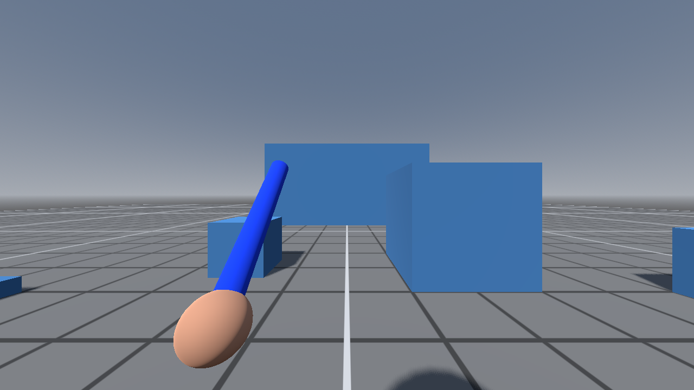
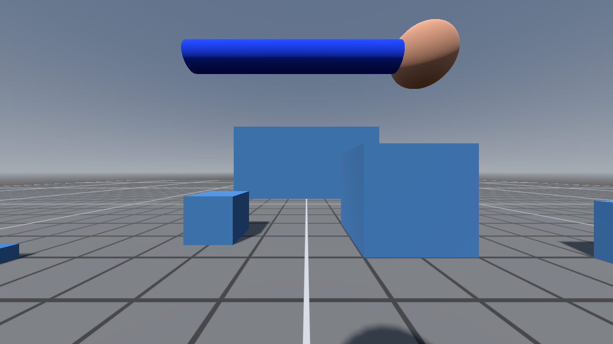
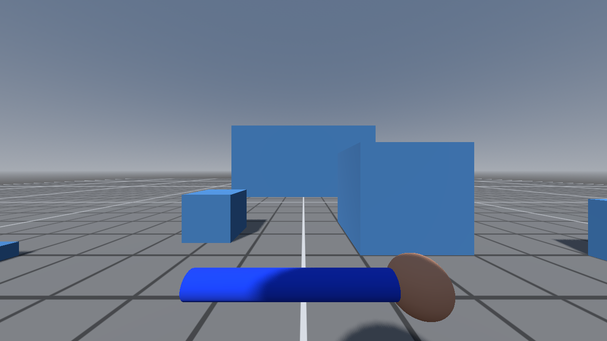
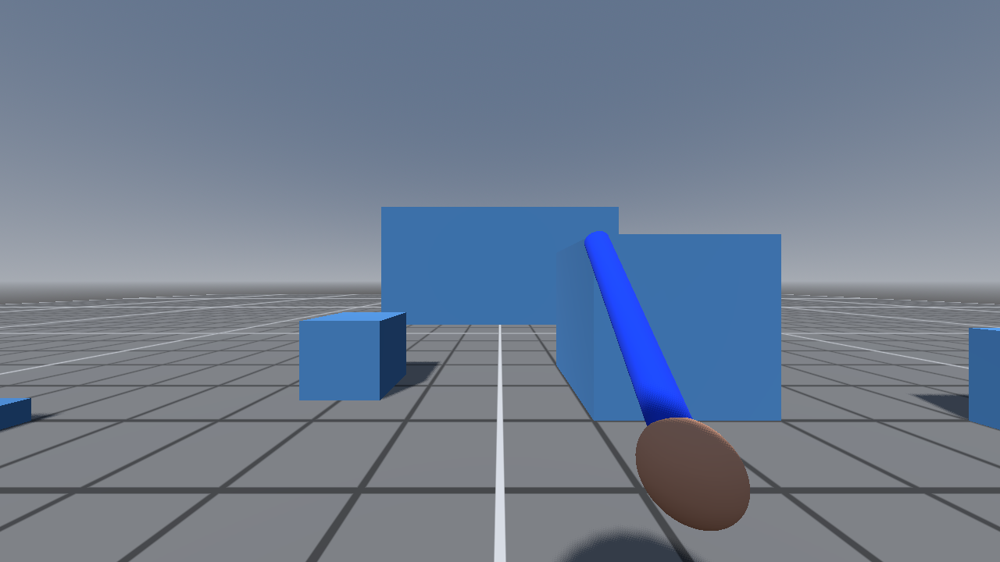

**Started:** November 2026  
**Status:** In progress  
**Latest update:** Devlog 001, November 4, 2026

## About the Project

A first-person melee game planned for online co-op, built in Godot 4. Combat
is about reading where an attack is coming from: you hold a guard in one of
four directions, swing from the guard you're holding, and block, brace or
parry strikes by guarding the side they land on.

I'm building it with Claude Code as a development partner. This page tracks
how the game is progressing, with a devlog entry for each milestone.

## How It's Built

* **Engine:** Godot 4 with statically typed GDScript
* **AI partner:** Claude Code, making scene changes live in the Godot editor through an editor plugin
* **Project memory:** a CLAUDE.md file of project rules that carries context from one session to the next
* **Devlog pipeline:** a scripted showcase scene plays through the mechanics on its own and records itself with Godot's movie mode, so every update's clips and screenshots are reproducible
* **Architecture:** built for online co-op from the start, with your own movement handled on your machine and the host deciding the outcome of every hit

## Progress

| Milestone | Status |
|---|---|
| First-person movement | Done |
| Four-direction guards and swings | Done |
| Directional blocking, bracing and parrying | Done |
| Training dummy with telegraphed attacks | Done |
| Hit, block and parry feedback | Done |
| Health and stamina | Next |
| An enemy that guards and blocks back | Planned |
| Online play between players | Planned |
| Real weapon models and sounds | Planned |

## Devlog

### 001: Guard, Strike, Parry
*November 4, 2026*

The first playable piece: a first-person character who can hold a guard in
four directions, swing from any of them, and block or parry a training
dummy's attacks.

  <video src="/images/claude-game-project/001-showcase.mp4" autoplay loop muted playsinline style="width: 100%; max-width: 800px; border-radius: 8px; box-shadow: 0 4px 8px rgba(0,0,0,0.3);"></video>
  
<em>Every guard, a swing from each, then the dummy's attacks: a hit taken, a normal block, a braced block and a parry</em>

  

    
    
<em>Left guard</em>

  

  

    
    
<em>Up guard</em>

  

  

    
    
<em>Down guard</em>

  

  

    
    
<em>Right guard (also the rest position)</em>

  

**What's new**

* Four guard directions you can switch between at any time
* Swings that start from your current guard and follow through across the screen, leaving a trail
* Directional blocking: the guard has to face the side the blade reaches you from, and hits from behind can't be blocked
* Right click to brace for a sturdier but slower block, or to parry if timed just before impact
* A training dummy that shows its attack direction and flashes orange right before it strikes
* Distinct feedback for every outcome: flashes, sparks, dust, optional blood, damage numbers, screen-edge warnings and brief impact pauses that freeze only the two fighters, so other co-op players aren't affected

**Problems solved**

* **Blocks sometimes judged the wrong side.** Fast sweeps were occasionally read as coming from the opposite side. Hit judging now follows the moment the blade first reaches the defender, tested from every direction around the player.
* **Parrying was too easy.** It first came from switching guard at the last moment, which rewarded mashing. It moved to a deliberate button, with a short lockout for presses that don't meet an attack.
* **Inputs got lost mid-swing.** The game now remembers your latest press and acts on it as soon as the swing allows.
* **The overhead trail was invisible.** A perfectly vertical swing lines up with the first-person camera, so vertical swings now come down slightly off center.
