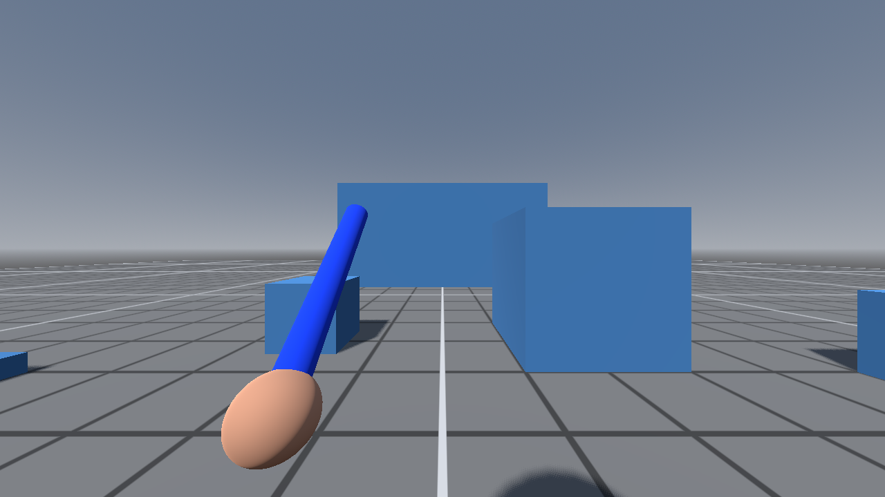
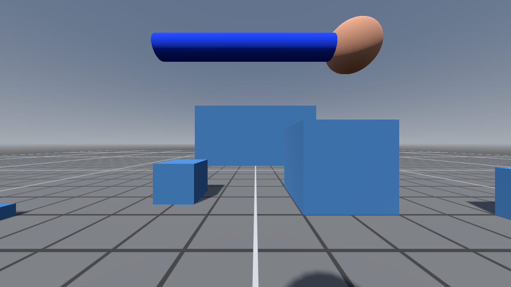
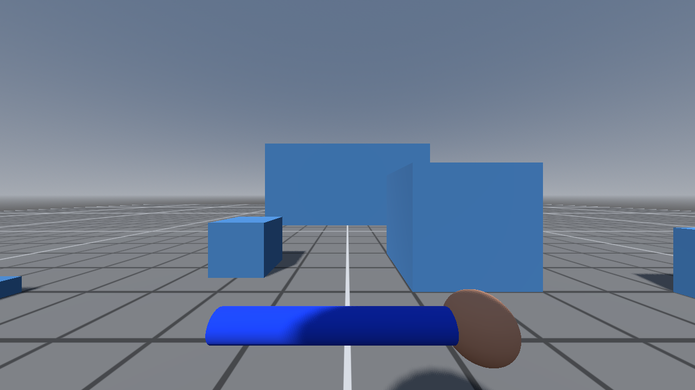
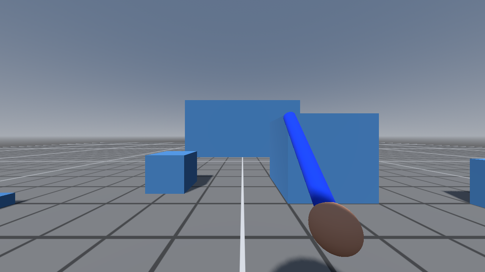

**Project Duration:** November 2026 - present  
**Status:** In progress

## Project Overview

A first-person melee combat prototype for an online co-op game, built in
Godot 4. Combat is built around reading where an attack is coming from: you
hold a guard in one of four directions, swing from the guard you're holding,
and block, brace or parry incoming strikes by guarding the side they land on.

  <video src="/images/melee-combat/showcase.mp4" autoplay loop muted playsinline style="width: 100%; max-width: 800px; border-radius: 8px; box-shadow: 0 4px 8px rgba(0,0,0,0.3);"></video>
  
<em>Every guard, a swing from each, then a training dummy's attacks: a hit taken, a normal block, a braced block and a parry</em>

## Guard Poses

  

    
    
<em>Left guard</em>

  

  

    
    
<em>Up guard: blade across the top of the screen</em>

  

  

    
    
<em>Down guard: blade across the bottom</em>

  

  

    
    
<em>Right guard (also the rest position)</em>

  

## Key Features

* **Four guard directions** you can switch between at any time
* **Swings that start from your current guard** and follow through across the screen, leaving a trail
* **Directional blocking**: holding the right guard stops a hit from that side; hits from behind can't be blocked
* **Block, brace or parry** with right click: bracing is sturdier but slows you, a well-timed press parries
* **Telegraphed enemy attacks**: the training dummy shows its direction and flashes right before it strikes
* **Readable feedback** for every outcome: flashes, sparks, dust, blood (optional), damage numbers, screen-edge warnings and brief impact pauses

## Design

**Guarding by direction.** You pick one of four guards and your weapon moves
to that side of the screen. A guard stays up until you choose another, so you
can watch the enemy instead of holding keys down. A block works only if your
guard faces the side the blade actually reaches you from, which keeps both
reading the enemy and positioning important.

**Swinging.** Every swing starts from the guard you're holding, so choosing a
guard also chooses your next attack. Swings carry through past the target
instead of stopping dead, which makes them feel heavier. Once the strike is
over you can cut the follow-through short to change guard or swing again, so
skilled players can chain actions without the game feeling sluggish.

**Blocking, bracing and parrying.** A plain block stops most of a hit but
still costs a little. Holding right click braces you: the block absorbs
everything and costs less, but you swing and move slower, so bracing is a
commitment. Pressing right click just before the blow lands is a parry, which
costs nothing and leaves the attacker briefly unable to strike back. Mashing
right click doesn't work: a press that isn't followed by a hit briefly stops
you from parrying, so parries have to be read and timed.

**Reading the enemy.** The training dummy moves its blade into the direction
it's about to attack from and holds it long enough to react. Right before the
swing lands its blade flashes orange: guard the matching side and press right
click while it's lit to parry.

**Feedback.** Each outcome has its own effect so it reads instantly. Getting
hit lights up the edge of the screen on the side you were struck from. Impact
pauses freeze only the two fighters involved, never the whole game, because in
co-op a global slowdown would freeze every other player too.

## Technical Approach

* **Godot 4 and GDScript**, with statically typed scripts
* **Built for online co-op from the start**: your own movement is handled on
  your machine for responsiveness, while the host decides the outcome of every
  hit
* **A shared component handles blocking** for both players and enemies
* **All effects live in a separate feedback component** that only listens for
  results, keeping the combat rules and the presentation independent
* **Automated capture**: a scripted showcase scene plays through the guards,
  swings and attacks on its own, recorded with Godot's built-in movie
  recording, so screenshots and video for each update are reproducible
* An AI assistant makes scene changes through an editor plugin, so every
  change shows up live in the editor

## Problems Solved

* **Blocks sometimes judged the wrong side.** Fast sweeps were occasionally
  read as coming from the opposite side, which made blocking feel random. Hit
  judging was reworked to follow the moment the blade first reaches the
  defender and how it's really travelling, then tested from every direction
  around the player.
* **Parrying was too easy.** Parrying first came from switching guard at the
  last moment, which happened by accident and rewarded mashing. It moved to a
  deliberate button with a short lockout for presses that don't meet an
  attack.
* **Inputs got lost mid-swing.** Presses during a swing used to do nothing.
  The game now remembers the latest press for a moment and acts on it as soon
  as the swing allows.
* **The overhead trail was invisible.** From first person a perfectly vertical
  swing lines up with the camera and its trail disappears, so vertical swings
  now come down slightly off center.

## Next Steps

* Health and stamina, so blocks and hits have real consequences
* An enemy that guards and blocks back
* Online play between players
* Real weapon models and sounds in place of the placeholders
